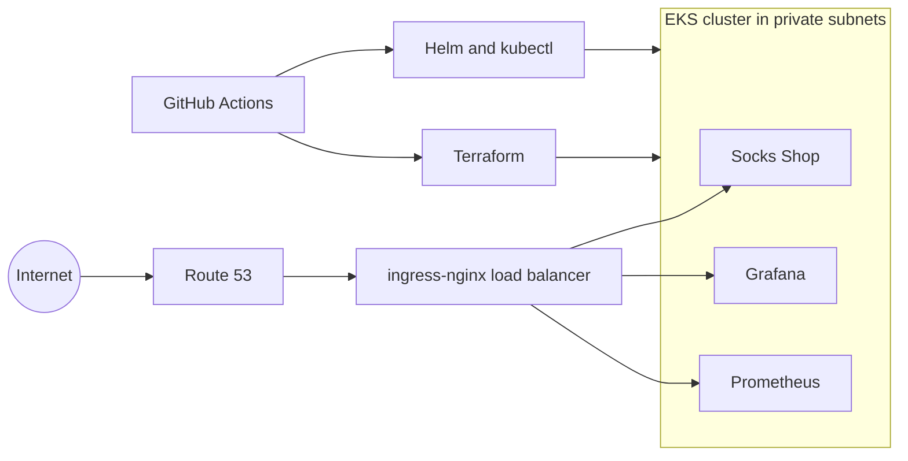

# Microservices Platform on Amazon EKS

This repository runs the Socks Shop microservices demo on Amazon EKS. Terraform builds the network and the cluster. Kubernetes manifests and Helm charts run the shop and its monitoring, and two GitHub Actions workflows run both steps.

## What It Builds

- A VPC in us-east-1 across three Availability Zones, with three public and three private subnets and a single NAT gateway.
- An EKS 1.30 cluster with two managed node groups of t3.small instances, running in the private subnets.
- An IAM role for the EBS CSI driver, assumed through the cluster's OIDC provider (IRSA).
- Terraform state in an encrypted S3 bucket.
- The Socks Shop services in the `sock-shop` namespace, behind ingress-nginx.
- Prometheus and Grafana from the kube-prometheus-stack chart.
- Route 53 records for the shop, Grafana and Prometheus.

## Architecture



## Repository Layout

| Path | What it holds |
|---|---|
| `terraform/vpc.tf` | The VPC, from the `terraform-aws-modules/vpc` module |
| `terraform/eks-cluster.tf` | The cluster, both node groups and the EBS CSI role |
| `terraform/s3-backend.tf` | Remote state in S3 |
| `terraform/terraform.tfvars` | The CIDR ranges |
| `kubernetes/deployment.yaml` | The Socks Shop namespace, deployments and services |
| `kubernetes/ingress.yaml` | Host rules for the shop, Grafana and Prometheus |
| `.github/workflows/terraform.yml` | Builds the infrastructure |
| `.github/workflows/kubernetes.yml` | Installs the charts and applies the manifests |

## Deploy It

You need an AWS account, the AWS CLI, Terraform, kubectl and Helm.

Warning: EKS, the NAT gateway and the load balancer bill by the hour. Run `terraform destroy` when you finish.

The state bucket has to exist before `terraform init`. Bucket names are global, so change the name in `terraform/s3-backend.tf` first, then create it:

```bash
aws s3 mb s3://sockshop-terraform-state-bucket --region us-east-2
```

Build the network and the cluster:

```bash
cd terraform
terraform init
terraform plan
terraform apply
```


The cluster, the VPC and the node instances in the console:


Point kubectl at the cluster:

```bash
aws eks update-kubeconfig --name alameen-eks-cluster --region us-east-1
```

Deploy the shop:

```bash
kubectl apply -f kubernetes/deployment.yaml
```


Install ingress-nginx, which creates the load balancer:

```bash
helm repo add ingress https://kubernetes.github.io/ingress-nginx
helm upgrade --install ingress ingress/ingress-nginx
```

Install Prometheus and Grafana in the shop's namespace. The ingress rules expect this release name:

```bash
helm repo add prometheus-community https://prometheus-community.github.io/helm-charts
helm install prometheus-community prometheus-community/kube-prometheus-stack --namespace sock-shop
```


Point the three hostnames in Route 53 at the load balancer. The hosts are in `kubernetes/ingress.yaml`, so change them to your own domain, then apply the rules:

```bash
kubectl apply -f kubernetes/ingress.yaml
```


Check the services:

```bash
kubectl get svc -n sock-shop
```


## The Running Platform

The shop:


Prometheus and Grafana:


## The Pipelines

`terraform.yml` runs on a push to the `terraform` branch, or by hand. It creates the state bucket, installs kubectl, Helm and Terraform, applies the Terraform, updates the kubeconfig and creates the `sock-shop` namespace.

`kubernetes.yml` runs on a push or pull request to `master`, or by hand. It installs cert-manager, installs ingress-nginx and kube-prometheus-stack with `helm upgrade --install`, and applies everything in `kubernetes/`.


## What I Would Change Now

- Replace the stored access keys in both workflows with an IAM role that GitHub Actions assumes through OIDC, so no long-lived key sits in the repository secrets.
- Lock the state. The S3 backend has no lock, so two runs could write the state at once. The backend's `use_lockfile` setting fixes that.
- Finish HTTPS. The pipeline installs cert-manager, but there is no issuer or certificate yet, so the ingress serves plain HTTP.
